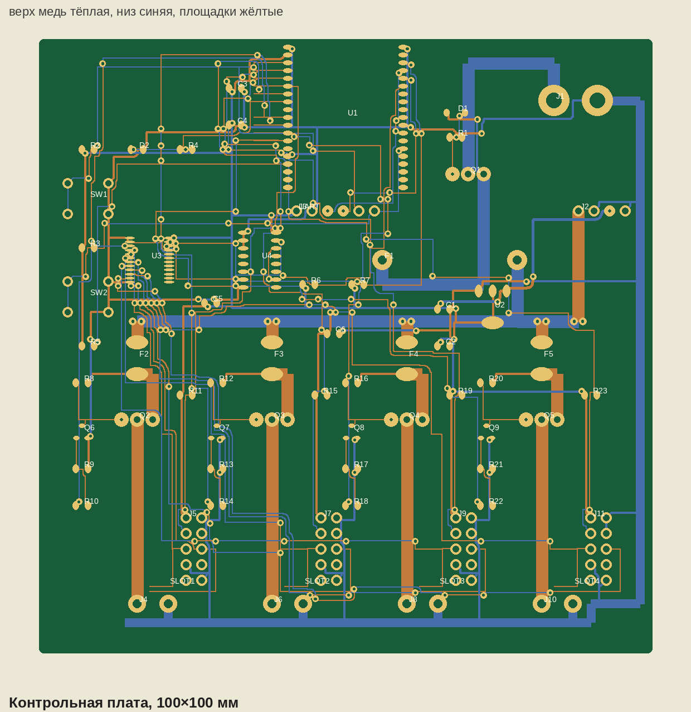
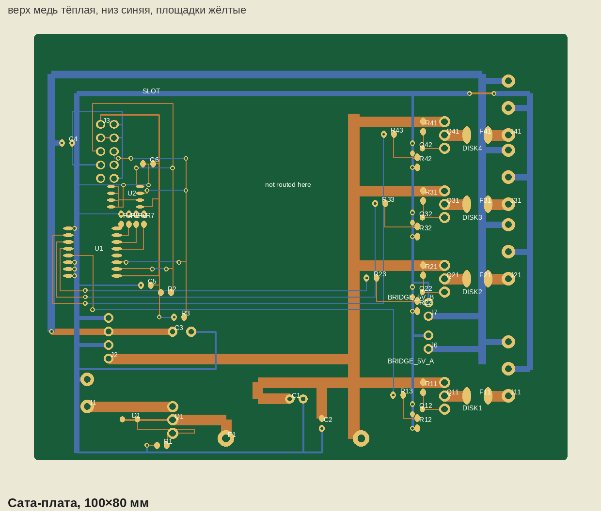
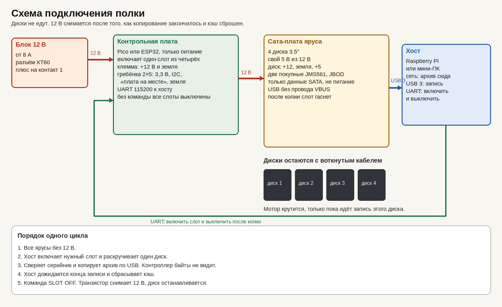

# sata-library

Полка, в которой диски 3.5" лежат на местах. Ярус — четыре диска и высота 1U. Два яруса — 8 дисков, третий ставится теми же деталями. Одновременно под 12 В только одна сата-плата, и на ней моторы раскручиваются по одному.

Контроллер — ESP32. Он включает питание. Байты архива через ESP32 не идут: у него нет SATA, а USB слишком медленный для диска. Архив принимает Raspberry Pi 4 или мини-ПК и пишет его через покупные мосты USB–SATA командой `rsync`. Договор разъёмов — [hardware/INTERFACE.md](hardware/INTERFACE.md).

| что | чем открыть |
| --- | --- |
| схема и плата | KiCad 8, проекты в `hardware/controller` и `hardware/sata-board` |
| корпус | OpenSCAD, файлы в `cad/stack`. Картинка двух ярусов ниже |
| печать | PrusaSlicer, Cura или OrcaSlicer, STL из OpenSCAD |
| прошивка | VS Code с PlatformIO или Arduino IDE, каталог `hardware/controller/firmware` |








Платы заказывать нельзя. Зоны земли не залиты, DRC не прогнан, на сата-плате входной IRF4905 и стабилитрон D1 разведены неверно. Смотреть файлы: `flatpak run org.kicad.KiCad` (KiCad 10; файлы записаны как KiCad 8, сохранение поднимает формат). Футпринт XT60 на контроллере — заглушка, его подгоняют под разъём в руках.

Наборный ярус описан в [cad/stack/README.md](cad/stack/README.md). Порядок включения — в [docs/banks.md](docs/banks.md). Что ещё не закрыто без детали в руках — в [docs/open-questions.md](docs/open-questions.md).

Ниже отдельно лежит первая стойка на один юнит и примерка одного отсека. Наборный ярус их файлы не переписывает: `cad/rack.scad`, `cad/bay.scad`.

## С чего печатать ярус

```bash
make stl
```

Нужен OpenSCAD. В `cad/out/` появятся STL примерки и яруса. Ярус — файлы `stack-*.stl`.

PETG, сопло 0.4 мм, слой 0.2 мм, три стенки. Сколько каких деталей и какой длины трубки — в [cad/stack/README.md](cad/stack/README.md). Длинные пролёты не печатаются: это трубки 6 мм. Печатная деталь влезает в 170 мм.

## Софт

Хост включает слот и один диск, сверяет серийник и вызывает `rsync`. Паузу между раскрутками (`spin_pause_s`, в примере 8 с) держит хост. Сухой прогон на плату не выходит и `rsync` не запускает.

```bash
make test
PYTHONPATH=src python3 -m sata_library backup \
  --config config/library.example.toml --slot 1 --disk 1 --source /data --dry-run
```

В примере серийник `REPLACE-ME`, и сухой прогон подставляет его же. Это не чтение полки. Пока в манифесте пустая строка, копирование запрещено: сначала `identify`, потом серийник руками в TOML.

Живой контроллер:

```bash
PYTHONPATH=src python3 -m sata_library backup \
  --config config/library.toml --slot 1 --disk 1 --source /data --port /dev/ttyUSB0
```

Без `--port` команда останавливается с `not_connected`. Порт — 115200 8N1, строки из [docs/controller.md](docs/controller.md). `path_contains` на живом запуске обязателен. `mount` — уже смонтированный каталог диска, туда пишет `rsync -a`.

Диски разбираются из `lsblk -J`. У моста USB–SATA поле `tran` часто `usb`, поэтому полка фильтруется строкой `path_contains`, а не типом шины.

## Первая примерка и стойка 1U

Калибр и салазки — от варианта с подвижным разъёмом. Боевая полка их не использует.

`gauge.stl` — короткий ложемент, если снова мерить, где на корпусе сидит разъём. Диск кладётся к левому борту и на пол, задней плоскостью к нулю линеек. Окно в `sled.scad` сейчас по центру пластины и размером разъёма не является. Питание на эту примерку не подавать.


Каркас на один юнит — четыре уголка и восемь трубок, корзина на каждый диск.


`corner.stl` содержит левый и правый уголок. Печатать файл дважды. Гнездо 8.4 мм принимает трубку от 4 до 8 мм. В сборке по умолчанию трубка 6 мм: между верхней и нижней остаётся 29 мм, из них 1.6 мм пол корзины и 26.1 мм диск. Число корзин и диаметр задаются в `cad/params.scad`. Подробности в [docs/rack.md](docs/rack.md).

## Документы

- [docs/concept.md](docs/concept.md) — роли хоста и контроллера
- [docs/banks.md](docs/banks.md) — включение слота и одного диска
- [docs/controller.md](docs/controller.md) — текстовый протокол
- [docs/rack.md](docs/rack.md) — каркас 1U из уголков и трубок
- [docs/mechanics.md](docs/mechanics.md) — первая примерка подвижного разъёма
- [docs/hardware.md](docs/hardware.md) — из чего собрать: хост ARM, SATA или USB, питание и каркас
- [docs/open-questions.md](docs/open-questions.md) — что решить дальше
- [hardware/INTERFACE.md](hardware/INTERFACE.md) — разъёмы, питание, I2C

Лицензия MIT.
