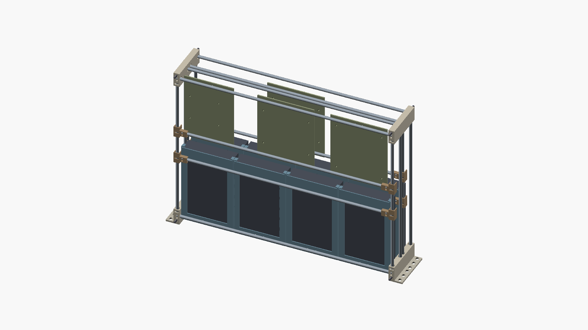
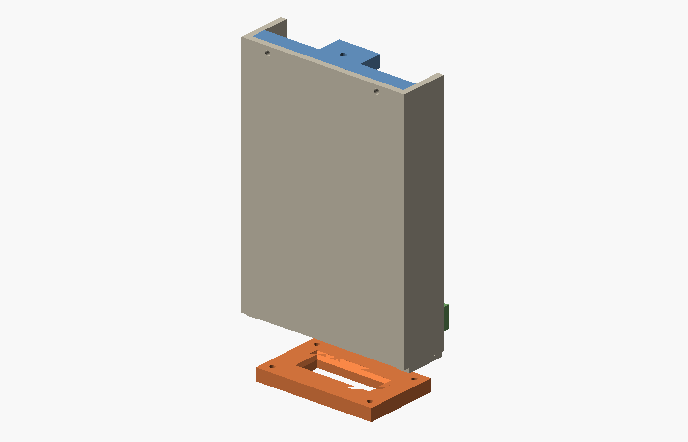
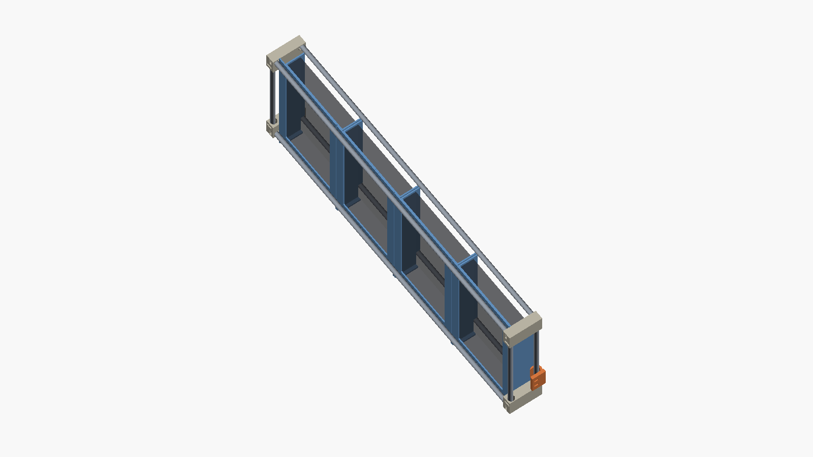

# sata-library

Полка, в которой диски 3.5" лежат на местах. Ярус — четыре диска и высота 1U. Два яруса — 8 дисков, третий ставится теми же деталями. Одновременно под 12 В только одна сата-плата.

Контроллер — ESP32. Он включает питание и по очереди раскручивает диски. Байты архива через ESP32 не идут: у него нет SATA, а USB слишком медленный для диска. Архив принимает Raspberry Pi 4 или мини-ПК и пишет его в диски через покупные мосты USB–SATA. Договор разъёмов — [hardware/INTERFACE.md](hardware/INTERFACE.md).

| что | чем открыть |
| --- | --- |
| схема и плата | KiCad 8, проекты в `hardware/controller` и `hardware/sata-board` |
| корпус | OpenSCAD, файлы в `cad/stack`. Картинка двух ярусов ниже |
| печать | PrusaSlicer, Cura или OrcaSlicer, STL из OpenSCAD |
| прошивка | VS Code с PlatformIO или Arduino IDE, каталог `hardware/controller/firmware` |



Платы заказывать нельзя, пока в KiCad не пройден Design Rules Checker: здесь его прогнать было нечем. Футпринт XT60 на контроллере — заглушка, его подгоняют под разъём в руках.

Ниже — первая стойка на один юнит и старая схема двух банков. Наборный ярус их не заменяет в файлах `cad/rack.scad` и `docs/banks.md`.

Полка на четыре корзины без каретки описана в [docs/banks.md](docs/banks.md).

Здесь же начало: модель одного отсека для примерки, каркас 1U из трубок и сухой прогон. Прогон пока говорит командами каретки. Спорные развилки собраны в [docs/open-questions.md](docs/open-questions.md).



На картинке длина диска идёт вверх. Сверху передний упор, снизу салазки разъёма, между ними отсек. Диск внутри и с этого ракурса закрыт стенкой.

## С чего печатать

Сначала калибр, не стойку.

```bash
make stl
```

Нужен OpenSCAD. В `cad/out/` появятся STL.

`gauge.stl` — короткий ложемент. Диск кладётся к левому борту и на пол, задней плоскостью к нулю линеек. Длинная риска — 10 мм, короткая — 5 мм. Записать, где сидит разъём относительно этого нуля. Окно в `sled.scad` сейчас по центру пластины и размером разъёма не является.

Дальше, если калибр сел: `bay.stl`, `front_plate.stl`, `strap.stl`. Салазки нужны, чтобы приложить покупной разъём руками. Питание на эту примерку не подавать.

Материал — PETG. Сопло 0.4 мм, слой 0.2 мм, три стенки. Пластины и планка уже лежат в STL отверстиями вверх, отсек и калибр — полом вниз. У задних уголков козырёк 3 мм.

## Стойка 1U

Каркас не печатается целиком. Четыре уголка и восемь трубок, корзина на каждый диск.



На картинке стойка лежит плашмя. Серые плиты — диски. Оранжевая деталь на боковой трубке — клипса концевика.

`corner.stl` содержит левый и правый уголок. Печатать файл дважды: получатся четыре угла. Полом вниз. `basket.stl` и `endstop_clip.stl` тоже полом вниз.

Гнездо уголка 8.4 мм, в него входит трубка от 4 до 8 мм. Хомут притягивает её к внешней стенке гнезда. В сборке по умолчанию трубка 6 мм: между верхней и нижней остаётся 29 мм, из них 1.6 мм пол корзины и 26.1 мм диск. Трубка 8 мм этот диск в юните 44 мм уже не несёт. Число корзин и диаметр задаются в `cad/params.scad` (`bay_count`, `rod_d`).

Для четырёх корзин трубки такие:

| куда | длина | сколько |
| --- | --- | --- |
| поперёк, верх и низ | 444.6 мм | 4 |
| вдоль борта, верх и низ | 133.4 мм | 4 |

Четыре корзины занимают 448.6 мм и входят в просвет 450 мм между направляющими. Гнездо трубки для этого 10 мм, борт корзины 1.6 мм. Подробности в [docs/rack.md](docs/rack.md).

## Софт

Хост решает, какой отсек свой и какой серийник должен там оказаться. Шаги моторов считает будущий контроллер. Сейчас контроллер подменяется сухим прогоном.

```bash
make test
PYTHONPATH=src python3 -m sata_library backup \
  --config config/library.example.toml --bay 1 --source /data --dry-run
```

В примере серийник `REPLACE-ME`, и сухой прогон подставляет его же. Это не чтение полки. Пока в манифесте пустая строка, копирование запрещено: сначала `identify`, потом серийник руками в TOML.

Живой порт ещё не подключён. Команда без `--dry-run` останавливается с `not_connected`.

Диски разбираются из `lsblk -J`. У моста USB–SATA поле `tran` часто `usb`, поэтому полка фильтруется строкой `path_contains`, а не типом шины.

## Документы

- [docs/concept.md](docs/concept.md) — роли хоста и контроллера
- [docs/banks.md](docs/banks.md) — два контроллера SATA, включение по очереди
- [docs/mechanics.md](docs/mechanics.md) — базы размеров и детали
- [docs/rack.md](docs/rack.md) — каркас 1U из уголков и трубок
- [docs/controller.md](docs/controller.md) — текстовый протокол
- [docs/open-questions.md](docs/open-questions.md) — что решить дальше

Лицензия MIT.
